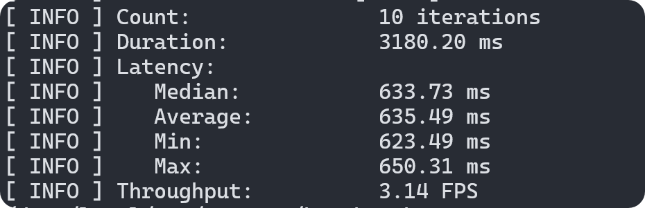

# Report: OpenVINO Cross-Compilation and Inference on Android (ARM64)

**Date:** October 2026
**Task:** Cross-compile OpenVINO Runtime for Android (aarch64) and test neural network inference using `benchmark_app` on a mobile device.

## 🛠 Build Process
*   Cross-compiled OpenVINO Runtime and OneTBB for Android (aarch64).
*   Encountered a `cmake --install` failure due to the missing `libopenvino_ir_frontend.so` library.
*   **Solution:** Performed a targeted rebuild of the specific CMake target (`--target openvino_ir_frontend`), after which the installation completed successfully.

## 📱 Testing Environment
*   **Device:** Poco X3 Pro (Android, ARM64)
*   **Model:** `yolo26n` (FP32)
*   **Execution flags:** `benchmark_app -m yolo26n.xml -d CPU -niter 10 -hint latency`

## 📊 Benchmark Results
*   **Count:** 10 iterations
*   **Duration:** 3180.20 ms
*   **Latency (median):** 633.73 ms
*   **Latency (average):** 635.49 ms
*   **Min / Max:** 623.49 ms / 650.31 ms
*   **Throughput:** 3.14 FPS
*   **First inference took:** 676.44 ms

  
   
  <i>Figure 1: Benchmark results for YOLO26n on Poco X3 Pro (ARM64)</i>

## 🔬 Layer Stats Analysis
Based on the collected `exec_graph.xml`, the top 5 slowest layers were identified:

1.  `Convolution (__module.model.0.conv...)` — 45.70 ms (primitive: `gemm_acl_f16`)
2.  `Convolution (__module.model.5.conv...)` — 40.36 ms (primitive: `gemm_acl_f16`)
3.  `Convolution (__module.model.3.conv...)` — 33.74 ms (primitive: `gemm_acl_f16`)
4.  `Convolution (__module.model.1.conv...)` — 24.71 ms (primitive: `gemm_acl_f16`)
5.  `Convolution (__module.model.2.cv2.conv...)` — 23.68 ms (primitive: `gemm_acl_f16`)

**Conclusion:** The majority of inference time (as expected for YOLO models) is spent on the initial convolution layers with high input resolution. OpenVINO on ARM successfully utilizes the **ARM Compute Library** (indicated by the `acl` prefix) in FP16 precision, which is optimal for mobile processors.