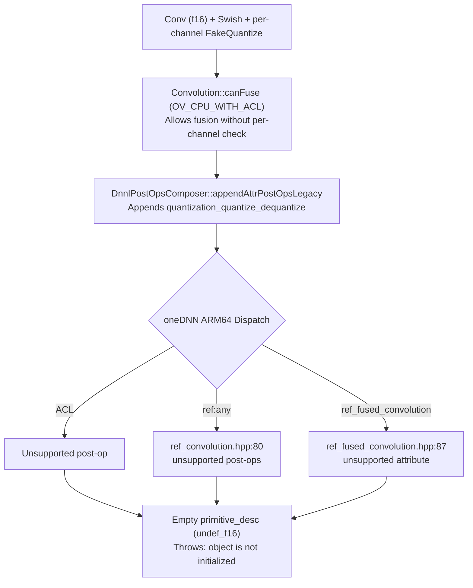

# ARM64 INT8 Crash Analysis: `object is not initialized` in OpenVINO

| Field | Value |
| :--- | :--- |
| **OpenVINO Build** | `2026.5.0-23685-29a0239fa3f` |
| **Plugin / Target** | `libopenvino_arm_cpu_plugin.so` (ARM64 / AArch64, Advanced SIMD) |
| **Model** | `yolo26n_int8.xml` |
| **Failure Stage** | `compile_model` (`Step 7/11` in `benchmark_app`), reproduces with `-infer_precision f32` |

> [!IMPORTANT]
> **TL;DR:** Under `OV_CPU_WITH_ACL`, `Convolution::canFuse` permits fusing a **per-channel** `FakeQuantize` after `Swish` into an `f16` convolution. `DnnlPostOpsComposer` lowers this into the x86-oriented `quantization_quantize_dequantize` post-op, which is rejected by every ARM64 oneDNN backend (ACL, `ref:any`, `ref_fused_convolution:any`). With no valid `primitive_desc` created, accessing the empty handle throws `object is not initialized`.

---

## Error Output

```text
[ ERROR ] Exception from src/inference/src/cpp/core.cpp:120:
Exception from src/inference/src/dev/plugin.cpp:54:
object is not initialized
```

## Failure Flow



---

## Localization

From `ONEDNN_VERBOSE=all` and the execution graph dump, compilation fails on layer **`id=1082`**:

- **Node:** `__module.model.23.cv3.0.0.1.conv/aten::_convolution/Convolution` (`1x1`, `ic=64`, `oc=80`, `80x80`)
- **Fused subgraph:** `Convolution + Add + Swish_76 + Swish_76/fq_output_0 (FakeQuantize)`
- **Key difference vs. working layers:** preceding `FakeQuantize` nodes (e.g., `Swish_75/fq_output_0`) use **per-tensor** bounds (`shape=""`), whereas `Swish_76/fq_output_0` uses **per-channel** bounds (`shape="1, 80, 1, 1"`, right before a depthwise `GroupConvolution`).

<details>
<summary><strong>Click to expand <code>ONEDNN_VERBOSE=all</code> dispatch failure log</strong></summary>

```text
onednn_verbose,v1,primitive,create:dispatch,convolution,cpu,convolution,ref:any,forward_inference,src:f16::blocked:acdb::f0 wei:f16:a:blocked:abcd::f0 bia:f16::blocked:a::f0 dst:f16::blocked:acdb::f0,attr-scratchpad:user attr-acc-mode:relaxed attr-post-ops:eltwise_swish:1+quantization_quantize_dequantize,alg:convolution_direct,mb1_ic64oc80_ih80oh80kh1sh1dh0ph0_iw80ow80kw1sw1dw0pw0,unsupported post-ops,src/cpu/ref_convolution.hpp:80
onednn_verbose,v1,primitive,create:dispatch,convolution,cpu,convolution,ref_fused_convolution:any,forward_inference,src:f16::blocked:acdb::f0 wei:f16:a:any:any::f0 bia:f16::blocked:a::f0 dst:f16::blocked:acdb::f0,attr-scratchpad:user attr-acc-mode:relaxed attr-post-ops:eltwise_swish:1+quantization_quantize_dequantize,alg:convolution_auto,mb1_ic64oc80_ih80oh80kh1sh1dh0ph0_iw80ow80kw1sw1dw0pw0,unsupported attribute,src/cpu/ref_fused_convolution.hpp:87
```

</details>

---

## Root Cause Analysis

### 1. Missing per-channel guard in `Convolution::canFuse`
In `src/plugins/intel_cpu/src/nodes/conv.cpp:590–603` (`#if defined(OV_CPU_WITH_ACL)`), when the convolution input precision is `f16` (post-dequantization), `FakeQuantize` is allowed to fuse after `Swish` without checking whether its parameters are per-channel:

```cpp
if (fusedWith.back()->getType() == Type::Eltwise && node->getType() == Type::FakeQuantize) {
    const auto fqOutPrc = node->getOriginalOutputPrecisionAtPort(0);
    const auto convInPrc = getOriginalInputPrecisionAtPort(0);
    if (any_of(convInPrc, ov::element::u8, ov::element::i8) &&
        fusedWith.back()->getAlgorithm() == Algorithm::EltwiseSwish) {
        return false;
    }
    ...
    return canFuseSimpleOperation(node); // Allows per-channel FQ for f16/f32 inputs
}
```

### 2. Fallback to x86-only legacy quantization post-op
In `src/plugins/intel_cpu/src/dnnl_postops_composer.cpp:937–1038, 1123–1136`, per-tensor `FakeQuantize` nodes are decomposed into scalar `eltwise` ops (`linear + round + clip`). Per-channel `FakeQuantize` nodes cannot be decomposed this way and fall back to `appendAttrPostOpsLegacy()`, emitting `quantization_quantize_dequantize` (designed for x86 JIT injectors):

```cpp
dnnl::algorithm alg = postOp.type() == FakeQuantizePostOp::Type::quantization_only
                          ? dnnl::algorithm::quantization_quantize
                          : dnnl::algorithm::quantization_quantize_dequantize;
...
ops.append_quantization(alg, per_channel, all_default, offsets);
```

### 3. Universal backend rejection and empty handle exception
- **ACL backend:** does not support `eltwise_swish + quantization_quantize_dequantize`.
- **`ref:any`** (`src/cpu/ref_convolution.hpp:80`): `ref_post_ops_t::post_ops_ok()` rejects `quantization`.
- **`ref_fused_convolution:any`** (`src/cpu/ref_fused_convolution.hpp:85–87`): only accepts `{binary, eltwise, convolution}`:
  ```cpp
  VDISPATCH_CONV(attr()->post_ops_.has_default_values(
                         {binary, eltwise, convolution}),
          VERBOSE_UNSUPPORTED_ATTR);
  ```
- No `primitive_desc` is constructed (`primitiveType: undef_f16`), causing `include/oneapi/dnnl/dnnl_common.hpp:177–179` to throw:
  ```cpp
  if (allow_empty == false && result == nullptr)
      DNNL_THROW_ERROR(dnnl_invalid_arguments, "object is not initialized");
  ```

---

## Verification (Isolated A/B Reproducer)

Two minimal 3-layer models (`Conv 1x1 (64→80, 80x80) -> Swish -> FakeQuantize`) were tested on the same ARM64 device, differing **only** in the shape of the `FakeQuantize` bounds:

| Reproducer | `FakeQuantize` Bounds | Status | Details |
| :--- | :--- | :---: | :--- |
| `repro_scalar_fq.xml` | Per-tensor (`shape=""`) | ✅ Passed | Compile: `74.76 ms` · Inference: `2012.35 ms` (`ref_any_f16`) |
| `repro_per_channel_fq.xml` | Per-channel (`1x80x1x1`) | ❌ Crashed | Failed at `Step 7/11`: `object is not initialized` |

---

## Performance Side Effect & Proposed Fixes

> [!WARNING]
> **Severe Performance Fallback:** Even when `FakeQuantize` is per-tensor (non-crashing), fusing `Swish + FakeQuantize` into an `f16` convolution is unsupported by ACL. As a result, most convolutions in the model silently fall back to `ref_any_f16` (taking **`2012.35 ms`** for a single `1x1` convolution in the reproducer above).

- **Crash Fix:** In `Convolution::canFuse` (`OV_CPU_WITH_ACL`), disallow fusing `FakeQuantize` nodes that require `quantization_quantize_dequantize` (per-channel) so they execute as standalone nodes.
- **Performance Fix:** Restrict fusing `Swish` / `FakeQuantize` post-ops into `f16` convolutions under ACL to prevent mass fallback to `ref_any_f16` and restore execution on `gemm_acl_f16`.
